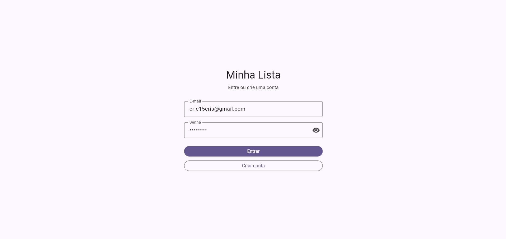
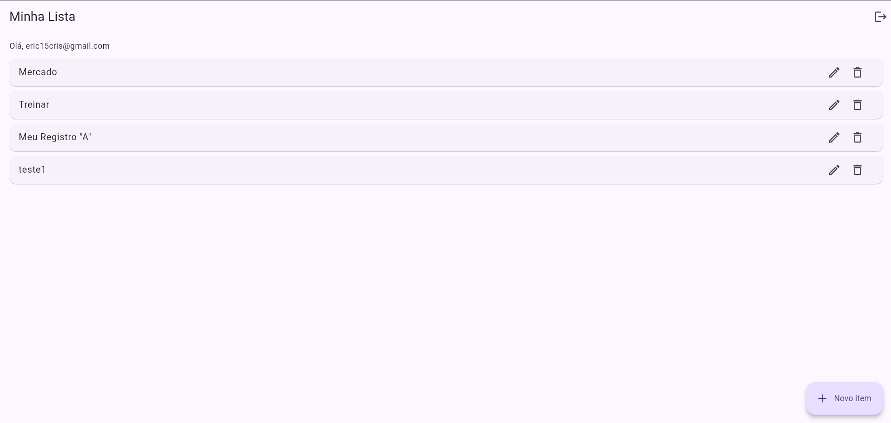

# Minha Lista

[](https://github.com/ericristhian/minha-lista/actions/workflows/deploy-pages.yml)


Aplicativo de lista pessoal com **login e CRUD na nuvem**, em que cada usuário só acessa os próprios dados. Projeto acadêmico da disciplina **Desenvolvimento de Dispositivos Móveis**.

**Demonstração online:** https://ericristhian.github.io/Minha-Lista/

<p align="center">
  
  
</p>

## Sobre o projeto

O app sai do estado local (memória da tela) e passa a persistir dados em um banco PostgreSQL na nuvem. A parte central do projeto é a **segurança no servidor**: a regra "cada usuário só vê e altera os próprios registros" é aplicada pelo banco com Row Level Security, e não pela interface.

## Funcionalidades

- Cadastro, login e logout por e-mail e senha
- Sessão persistida entre aberturas do app
- Listar, adicionar, editar e excluir itens
- Isolamento total entre contas
- Estados de carregamento, erro e lista vazia; puxar para atualizar

## Tecnologias

| Camada | Tecnologia |
|---|---|
| Interface | Flutter / Dart, Material 3 |
| Cliente | `supabase_flutter` 2.x |
| Autenticação | Supabase Auth |
| Banco | PostgreSQL (Supabase) via Data API |
| Segurança | GRANT/REVOKE + Row Level Security |
| Deploy | GitHub Actions + GitHub Pages |

## Arquitetura

```
Flutter (telas) -> supabase_flutter -> Supabase (Auth + Data API + RLS) -> PostgreSQL
```

O Auth identifica o usuário, o JWT acompanha cada requisição e o RLS decide quais linhas ele pode acessar.

## Estrutura de pastas

```
minha-lista/
├── .github/workflows/
│   └── deploy-pages.yml        # compila e publica no GitHub Pages
├── docs/screenshots/           # imagens usadas neste README
├── lib/
│   ├── main.dart               # inicialização do Flutter e do Supabase
│   ├── app.dart                # MaterialApp e AuthGate (login x lista)
│   ├── supabase_client.dart    # atalho para o cliente único
│   ├── pages/
│   │   ├── login_page.dart     # cadastro e login
│   │   └── items_page.dart     # lista e CRUD
│   ├── services/
│   │   └── item_service.dart   # SELECT, INSERT, UPDATE, DELETE
│   └── models/
│       └── item.dart           # modelo da tabela items
├── sql/
│   └── 01_minha_lista.sql      # tabela, RLS, grants e políticas
├── supabase_config.example.json
├── pubspec.yaml
└── README.md
```

## Modelo de dados

Tabela `public.items`

| Coluna | Tipo | Regra |
|---|---|---|
| id | uuid | chave primária, gerada automaticamente |
| name | text | obrigatório, não aceita vazio |
| user_id | uuid | referência a `auth.users(id)`, com `on delete cascade` |
| created_at | timestamptz | data e hora de criação |

## Decisões técnicas

- **RLS em vez de filtro na interface.** O app não filtra por `user_id` no SELECT. As políticas do banco garantem o isolamento mesmo se alguém chamar a API diretamente.
- **GRANT e RLS são camadas diferentes.** O GRANT define quais operações o papel pode executar; o RLS define em quais linhas. Foi concedido apenas o necessário ao papel `authenticated` (privilégio mínimo).
- **UPDATE com `USING` e `WITH CHECK`.** Impede que um usuário transfira um registro para outro `user_id`.
- **A publishable key fica no cliente.** Ela é pública por natureza; a segurança depende de Auth e RLS. A secret key nunca é usada no app.
- **Configuração fora do código.** URL e chave entram por `--dart-define-from-file`, e o arquivo real está no `.gitignore`. No deploy, os valores vêm dos *Secrets* do GitHub.
- **Separação de responsabilidades.** `pages/` cuida da interface, `services/` do acesso a dados e `models/` da representação das tabelas.
- **`AuthGate` com `onAuthStateChange`.** A navegação entre login e lista reage à sessão, sem controle manual de rotas.
- **Boas práticas assíncronas.** Tratamento de erro com `try/catch` e verificação de `mounted` após cada `await`.
- **SQL versionado.** O script em `sql/` reproduz o banco inteiro, sem depender de cliques no painel.

## Como executar localmente

Pré-requisitos: Flutter com Dart >= 3.9 e uma conta gratuita no Supabase.

1. **Crie um projeto no Supabase** e rode `sql/01_minha_lista.sql` em *SQL Editor -> New query -> Run*.
2. **Configure as chaves:** copie `supabase_config.example.json` para `supabase_config.json` e preencha a URL e a publishable key (*Dashboard -> Connect*).
3. **Habilite o login por e-mail** em *Authentication -> Sign In / Providers -> Email*. Para testes locais, você pode desativar *Confirm email*.
4. **Execute:**
   ```bash
   flutter pub get
   flutter run --dart-define-from-file=supabase_config.json
   ```

## Deploy

Cada push na branch `main` dispara o workflow `.github/workflows/deploy-pages.yml`, que compila o app web e publica no GitHub Pages. Os *Secrets* `SUPABASE_URL` e `SUPABASE_PUBLISHABLE_KEY` precisam estar cadastrados no repositório.

## Como validar o isolamento dos dados

1. Crie a conta A, entre e crie o item "Meu registro A".
2. Saia e entre com a conta B.
3. A lista de B não deve conter "Meu registro A".

## Problemas comuns

| Sintoma | Onde investigar |
|---|---|
| 401 / Invalid API key | URL ou publishable key incorreta |
| 403 / 42501 | GRANT, schema usage, Data API e políticas RLS |
| Lista vazia | RLS filtrando; conferir sessão e `user_id` |
| Cadastro sem sessão | *Confirm Email* ativo; confirmar o e-mail |

## Próximos passos

- Marcar itens como concluídos
- Login com Google
- Testes automatizados de widgets e do serviço
- Build Android (APK)

## Autor

**Eric Cristhian** • Engenharia de Software •
Disciplina: Desenvolvimento de Dispositivos Móveis
[LinkedIn](https://linkedin.com/in/ericristhian) • [GitHub](https://github.com/ericristhian)
